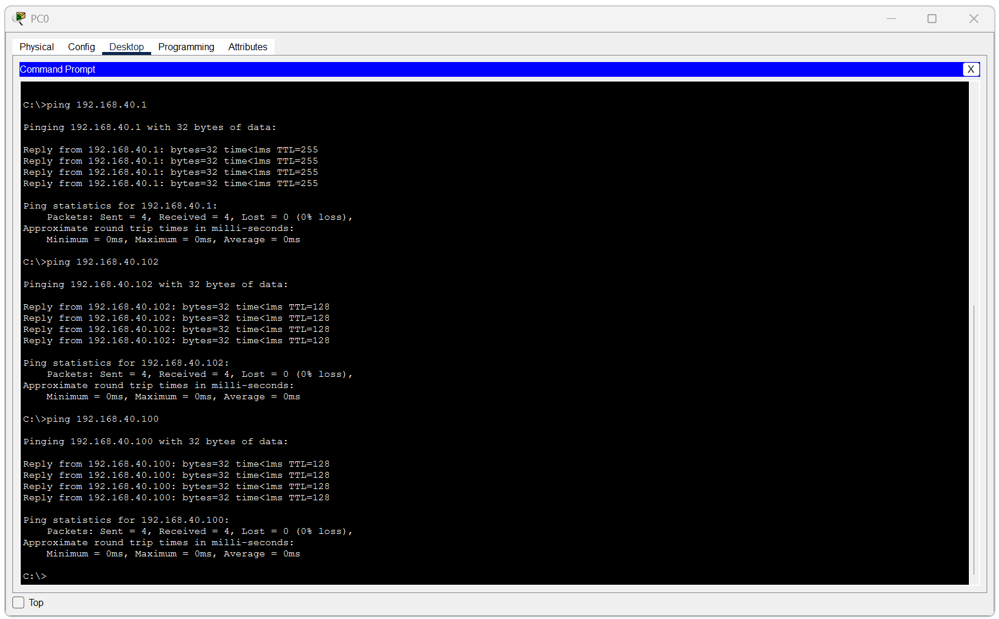
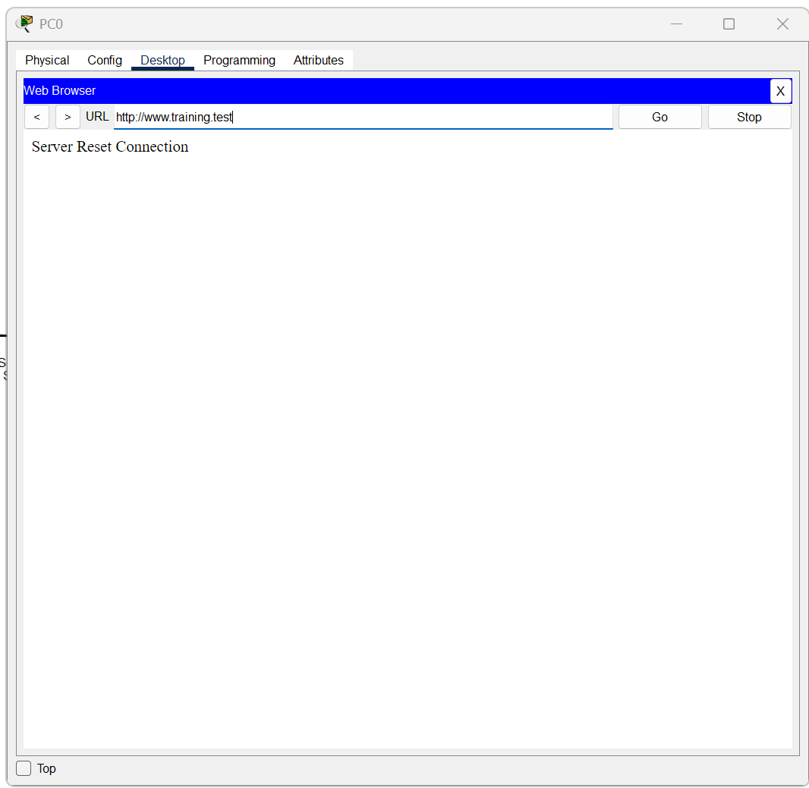

# Week 02 Networking Fundamentals

**Period:** 8 to 14 October 2026  
**Focus:** IPv4 addressing, DHCP, NAT, transport protocols, and application troubleshooting  
**Status:** Completed (recorded lab results and evidence limitations documented)  
**Primary Labs:** [DHCP](labs/lab-01-dhcp-connectivity.md) · [NAT](labs/lab-02-nat-packet-flow.md) · [DNS and HTTP](labs/lab-03-application-troubleshooting.md)  
**Files:** [Lab 03 Packet Tracer project](labs/packet-tracer/lab-03-application-troubleshooting.pkt) · [Simulator availability](labs/packet-tracer/README.md) · [Weekly review](assessment/week-02-review.md)

[Learning journey](../../README.md) | [Previous week: Networking foundations](../week-01/README.md)

---

## 1. Weekly Overview

The goal of Week 02 was to connect IPv4 addressing and network communication concepts with client configuration, address translation, and application behavior.

Building on Week 01's Ethernet, ARP, and routing foundations, I studied IPv4 address structure, subnet masks, network segmentation, DHCP, default gateways, NAT, TCP/UDP, and application services. The practical work focused on three Cisco Packet Tracer labs: configuring DHCP clients, comparing an HTTP request before and after NAT, and testing a controlled HTTP failure while checking IP connectivity and DNS separately.

The main objective was to identify what each configuration check or functional test actually establishes. DHCP acquisition, a successful ping, a DNS answer, and a displayed web page answer different questions.

The scheduled learning period was **8 to 14 October 2026**. Evidence collection and review continued through **18 October 2026**. All exercises took place in simulation.

---

## 2. Learning Completed

| Topic | Material | Status |
|---|---|---|
| IPv4 address purpose, 32-bit structure, network/host portions, and subnet masks | Cisco Networking Basics: Module 08, The Internet Protocol | Completed |
| Unicast, broadcast, multicast, public/private and special-use addresses, and network segmentation concepts | Cisco Networking Basics: Module 09, IPv4 and Network Segmentation | Completed |
| Static and dynamic configuration, DHCP pools, leases, and the Discover, Offer, Request, and ACK sequence | Cisco Networking Basics: Module 11, Dynamic Addressing with DHCP | Completed |
| Local versus remote delivery, default gateways, router DHCP roles, and source address translation | Cisco Networking Basics: Module 12, Gateways to Other Networks | Completed |
| TCP/UDP behavior, ports, application endpoints, and introductory connection information | Cisco Networking Basics: Module 15, TCP and UDP | Completed |
| DNS, HTTP/HTTPS, and introductory file transfer, email, and remote access services | Cisco Networking Basics: Module 16, Application Layer Services | Completed |
| Network testing utilities | Module 17, as recorded in the supplied learning record | Completion reported |

The reviewed private PDF contains detailed notes for Modules 08, 09, 11, 12, 15, and 16. Completion statuses follow the supplied learning record; they do not mean every concept was tested in these three labs. The utility reference labels supplementary material separately. Course PDFs are not redistributed here.

### Study notes

- [IPv4 addressing and network boundaries](notes/networking-fundamentals.md)
- [DHCP, gateways, and NAT](notes/dhcp-and-nat.md)
- [Transport and application services](notes/transport-and-applications.md)
- [Testing utilities and evidence limits](notes/network-testing-utilities.md)

Assessment sources and recorded results are documented in the [weekly review](assessment/week-02-review.md).

---

## 3. Skills Demonstrated

| Demonstrated capability | Evidence |
|---|---|
| Configure a DHCP pool and inspect client addresses, masks, gateway, and DHCP server | [DHCP report](labs/lab-01-dhcp-connectivity.md) |
| Check that three clients have distinct addresses within the configured pool | [PC0](evidence/lab-01-dhcp/03-pc0-ipconfig.png), [PC1](evidence/lab-01-dhcp/04-pc1-ipconfig.png), and [PC2](evidence/lab-01-dhcp/05-pc2-ipconfig.png) |
| Verify tested local ICMP reachability after inspecting configuration | [Connectivity tests](evidence/lab-01-dhcp/06-connectivity-test.png) |
| Compare source/destination addressing, TCP ports, and TTL across a NAT gateway | [NAT report](labs/lab-02-nat-packet-flow.md) |
| Build a same-subnet client/switch/server topology and configure a DNS A record and HTTP service | [Application lab](labs/lab-03-application-troubleshooting.md) |
| Separate IP reachability, name resolution, and HTTP results during a known service failure | [Failure-state ping and DNS](evidence/lab-03-application/07-connectivity-dns-during-failure.png) and [HTTP error](evidence/lab-03-application/08-http-access-failed.png) |
| Restore HTTP and verify functional page access | [Recovery result](evidence/lab-03-application/10-http-recovery-verified.png) |

These capabilities describe the documented exercises. The DHCP failure configuration discrepancy and the guided nature of Lab 03 remain relevant limitations.

---

## 4. Practical Work

### Lab reports

| Lab | Work and supported result |
|---|---|
| [01: DHCP and local connectivity](labs/lab-01-dhcp-connectivity.md) | Three clients held unique addresses within the configured pool. PC0 received 12 replies across three local ping tests. The failure/recovery captures include a pool discrepancy that limits a single-cause conclusion. |
| [02: NAT packet flow](labs/lab-02-nat-packet-flow.md) | The observed HTTP request changed source address from `192.168.1.101` to `209.165.200.227`. PC0 displayed the simulated external server's page. |
| [03: DNS and HTTP troubleshooting](labs/lab-03-application-troubleshooting.md) | Ping and DNS still succeeded when HTTP was deliberately disabled. The page loaded again after HTTP was restored. The stored project also passed a fresh HTTP check when reopened. |

### DHCP configuration and connectivity

The [topology](evidence/lab-01-dhcp/01-network-topology.png), [working pool](evidence/lab-01-dhcp/02-dhcp-server-configuration.png), [failed request](evidence/lab-01-dhcp/08-dhcp-request-failed.png), and [recovered request](evidence/lab-01-dhcp/10-dhcp-request-recovered.png) are linked in the full report. The disabled-service capture also shows a different pool; the experiment should not be presented as holding every other variable constant.

### NAT request comparison

| Field | Before forwarding | After forwarding |
|---|---|---|
| Source IPv4 | `192.168.1.101` | `209.165.200.227` |
| Destination IPv4 | `209.165.200.228` | `209.165.200.228` |
| TCP source / destination | `1027` / `80` | `1027` / `80` |
| TTL | 128 | 127 |

Inspect the [topology](evidence/lab-02-nat/01-nat-topology.png), [inbound PDU](evidence/lab-02-nat/02-before-nat-pdu.png), [outbound PDU](evidence/lab-02-nat/03-after-nat-pdu.png), and [HTTP result](evidence/lab-02-nat/04-nat-verification.png). Port preservation is an observation about this request, not a rule for all NAT behavior. The TTL decrement is a forwarding effect, distinct from address translation.

### HTTP failure with working IP and DNS checks

Compare the [topology](evidence/lab-03-application/01-lab-topology.png), [baseline](evidence/lab-03-application/05-http-baseline.png), [successful ping and DNS during failure](evidence/lab-03-application/07-connectivity-dns-during-failure.png), and [recovered page](evidence/lab-03-application/10-http-recovery-verified.png). The report explains why the browser error alone does not establish the exact TCP failure sequence.

### Reproduction and source files

Use Cisco Packet Tracer and follow each lab report's procedure. The reports describe which values can vary between runs and where the evidence does not specify a complete activity configuration.

The [Lab 03 project](labs/packet-tracer/lab-03-application-troubleshooting.pkt) is available as a `.pkt` file. I built its topology from scratch. Lab 01 and Lab 02 derive from Cisco learning activities, so their simulator files are withheld from public distribution. See [simulator availability and provenance](labs/packet-tracer/README.md). The Lab 02 source is a `.pka` activity and has not been renamed or represented as a `.pkt` project.

Work on copies when reproducing failures. The original evidence records specific runs; new runs should be documented separately.

---

## 5. Validation Results

| Test | Expected Result | Actual Result | Status | Evidence |
|---|---|---|---|---|
| DHCP client inventory | Clients hold unique addresses within the working pool | Three distinct addresses within `192.168.40.100` through `.119` | Pass | [DHCP report](labs/lab-01-dhcp-connectivity.md) |
| Local connectivity | Tested local targets answer PC0's ICMP requests | 4/4 replies from each of three targets, 12 replies total | Pass | [Ping output](evidence/lab-01-dhcp/06-connectivity-test.png) |
| DHCP request failure and recovery | A new request fails without the server and succeeds with working service/configuration | Failed and successful request messages recorded; the pool also differs between captures | Observed; causal limitation | [DHCP analysis](labs/lab-01-dhcp-connectivity.md#failed-request-and-recovery) |
| NAT request comparison | Source addressing is translated as traffic leaves the gateway | Source changed to `209.165.200.227`; destination and observed TCP ports remained unchanged | Observed | [PDU comparison](labs/lab-02-nat-packet-flow.md#comparing-the-request-at-the-gateway) |
| Simulated external HTTP access | PC0 displays the NAT activity's web page | Page displayed inside Packet Tracer | Pass | [Browser result](evidence/lab-02-nat/04-nat-verification.png) |
| HTTP fault with separate IP/DNS checks | Disabling HTTP prevents page access while the tested IP/DNS functions remain available | Ping returned 4/4 replies, DNS returned the expected address, and HTTP showed Server Reset Connection | Pass for the controlled test | [Fault analysis](labs/lab-03-application-troubleshooting.md#fault-injection-http-disabled) |
| HTTP recovery | Restoring HTTP allows the page to load again | Service restored and page displayed | Pass | [Recovery](evidence/lab-03-application/10-http-recovery-verified.png) |
| Stored Lab 03 project | Reopened project supports the tested HTTP access | HTTP/HTTPS and DNS were On, the expected A record was present, and a fresh HTTP request displayed the page | Pass for the reviewed access test | [Stored-file check](labs/lab-03-application-troubleshooting.md#stored-file-check-on-18-october-2026) |

The successful local ping tests do not verify WAN access or application health. The NAT page belongs to the simulation and does not establish real Internet connectivity. The stored-project check does not prove the file was saved after the original recovery event; its modification time predates the final recovery screenshots.

---

## 6. Troubleshooting and Corrections

Lab 01 records a failed DHCP request followed by a successful request after restoring the service and matching pool configuration. The disabled-service screenshot also contains a different pool, so it does not isolate service availability as the only changed variable. Dynamic lease assignments can also differ between recorded states without proving a configuration fault.

Lab 03 deliberately disabled HTTP while checking ping and DNS separately. Both checks remained successful, but the browser failed to load the HTTP page. Re-enabling HTTP restored page access. This was a guided controlled-failure exercise with a known injected cause, rather than independent diagnosis of an unknown incident.

The main correction was to distinguish a service-specific failure from a general connectivity failure. Successful ping does not prove DNS or HTTP health, and a DNS answer does not prove a web service is available. The browser's error message alone does not establish the precise TCP flag sequence or reset origin.

For a cleaner DHCP follow-up, keep the matching pool and all unrelated settings unchanged while toggling only DHCP availability. Preserve the existing evidence and document the new test separately.

---

## 7. Assistance and Limitations

AI assistance supported technical discussion, evidence review, and documentation. The reports distinguish my configuration and test work from later documentation checks and supplementary explanation.

Observed results, reasonable inferences, verified tests, and unverified details are identified in each report. The review did not reproduce every original action. Packet-level DORA, all NAT mappings and return traffic, detailed TCP failure behavior, and HTTPS access remain unverified. HTTPS being visibly enabled is not an HTTPS access test.

NAT does not provide encryption or a complete security policy. These labs do not establish independent production troubleshooting, enterprise deployment experience, a security assessment, or complete knowledge of every packet exchange. Studied services such as FTP, email, and remote access should not be treated as completed practical tests in these three labs.

Cisco course PDFs and proprietary activity files, credentials, and sensitive data are excluded from publication. Lab 03 is the only simulator project distributed for Week 02.

---

## 8. Review and Next Steps

The strongest outcome was learning to separate configuration acquisition, IP reachability, name resolution, and HTTP behavior before drawing a conclusion.

The main development areas are distinguishing root causes from consequences, locating the precise failure stage, and limiting claims to what the evidence supports. Lab 03 provided guided practice with these distinctions; it does not prove independent troubleshooting competence or that these weaknesses are permanently resolved.

Future records should keep current leases, test times, configuration changes, and output together. Save and reopen a working project copy before treating it as a reproducible final state, while preserving the original screenshots and source file.

Week 03 is planned around CLI and Git Foundations: Windows CMD and terminal basics, `ping`, `tracert`, `arp`, `netstat`, `nslookup`, Git fundamentals, Markdown, and interpretation of command output. An unfamiliar authorized fault can provide practice in writing a hypothesis and selecting tests before changing settings. This is planned work, not a completed exercise.

Assessment sources, review coverage, and the distinction between existing GitHub publication and planned learner-managed Git work are recorded in the [weekly review](assessment/week-02-review.md).
