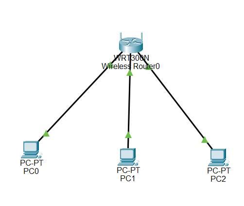

# Lab 01: DHCP and local connectivity

[Week 02 overview](../README.md) | [Simulator availability](packet-tracer/README.md)

I configured DHCP on a WRT300N, checked the IPv4 configuration of three clients, and tested local reachability. I also recorded a failed DHCP request and a later successful request after restoring the service and a matching pool configuration.

This exercise used a Cisco-derived activity in Packet Tracer. The original activity and its derived simulator file are not redistributed here. The screenshots record my configuration and test results.

## Topology and working configuration



PC0, PC1, and PC2 connect to the router's LAN switch ports through Ethernet links. Although the device supports wireless networking, this evidence does not document a Wi-Fi association test.

| Router setting | Value in the working configuration |
|---|---|
| LAN IPv4 address | `192.168.40.1` |
| Subnet mask | `255.255.255.0` |
| DHCP service | Enabled |
| Starting address | `192.168.40.100` |
| Maximum users | 20 |
| Displayed pool | `192.168.40.100` through `192.168.40.119` |

The [router configuration screenshot](../evidence/lab-01-dhcp/02-dhcp-server-configuration.png) shows these settings. DNS service was not part of this test; the client output shows DNS `0.0.0.0`.

The latest client inventory shows:

| Client | IPv4 address | Mask | Default gateway | Evidence |
|---|---|---|---|---|
| PC0 | `192.168.40.101` | `255.255.255.0` | `192.168.40.1` | [ipconfig](../evidence/lab-01-dhcp/03-pc0-ipconfig.png) |
| PC1 | `192.168.40.102` | `255.255.255.0` | `192.168.40.1` | [ipconfig](../evidence/lab-01-dhcp/04-pc1-ipconfig.png) |
| PC2 | `192.168.40.100` | `255.255.255.0` | `192.168.40.1` | [ipconfig](../evidence/lab-01-dhcp/05-pc2-ipconfig.png) |

All three addresses are distinct and within the configured pool. This inventory is separate from the earlier recovery capture described below. It should not be interpreted as a permanent address reservation for each client.

## Configuration and connectivity checks

The recorded configuration can be reproduced with the following procedure. These are reproduction instructions, not an additional test performed during documentation review.

1. Connect three PCs to LAN Ethernet ports on a WRT300N.
2. Open the router's GUI and Basic Setup page. Set its LAN address to `192.168.40.1` and mask to `255.255.255.0`.
3. Enable DHCP, set the starting address to `.100`, and set the maximum users to 20. Save the settings.
4. On each PC, open Desktop > IP Configuration and select DHCP.
5. Inspect the assigned configuration using `ipconfig /all`. Check uniqueness, subnet membership, gateway, and DHCP server.
6. Use the current client addresses for the ping tests. Do not assume the same lease order on every run.

In the captured run, I issued these commands from PC0:

```text
ping 192.168.40.1
ping 192.168.40.102
ping 192.168.40.100
```


| Target | Replies | Loss |
|---|---:|---:|
| Router LAN interface | 4/4 | 0% |
| PC1 | 4/4 | 0% |
| PC2 | 4/4 | 0% |

The 12 replies verify the tested local ICMP exchanges at that time. They do not verify DNS, HTTP, WAN connectivity, or access to the real Internet. All targets belong to the same subnet; the gateway setting is not needed to forward these particular local exchanges.

## Failed request and recovery

The evidence records these states:

| State | Directly observed evidence |
|---|---|
| Service disabled | [DHCP disabled](../evidence/lab-01-dhcp/07-dhcp-server-disabled.png) on the router |
| Request failed | [PC2 reports DHCP request failed](../evidence/lab-01-dhcp/08-dhcp-request-failed.png) |
| Working configuration restored | [DHCP enabled with a matching pool](../evidence/lab-01-dhcp/09-dhcp-server-restored.png) |
| Request recovered | [PC2 reports DHCP request successful](../evidence/lab-01-dhcp/10-dhcp-request-recovered.png) |

The disabled-service screenshot shows LAN address `192.168.40.1`, but its greyed DHCP pool reads `192.168.1.100` through `192.168.1.149`, with 50 users. The restored screenshot shows the matching `192.168.40.100` through `.119` pool with 20 users.

This discrepancy limits the causal conclusion. The client failed to obtain configuration in the captured disabled-service state, and later succeeded with the restored service and matching configuration. The captures do not isolate service availability as the sole changed variable across every state. Disabling DHCP is sufficient to prevent a new lease from that server, but the evidence should not be presented as a clean experiment with every other setting held constant.

The recovery screenshot shows PC2 at `192.168.40.102/24`, with gateway `192.168.40.1`. The later inventory shows PC2 at `.100`. These are different recorded lease states. The successful recovery request verifies address acquisition; the separate connectivity screenshot verifies the later local ICMP tests.

For a cleaner follow-up test, keep the matching LAN and pool configuration unchanged, disable only DHCP, make a fresh client request, then restore only the service and repeat the request. Do not overwrite the existing screenshots with new evidence or assume that disabling DHCP immediately removes an already valid client lease.

## Findings and limits

- **Observed:** the router settings, three assigned configurations, failed and recovered request messages, and ping output are visible in the linked screenshots.
- **Verified by the recorded tests:** all three clients held unique in-pool addresses in the latest inventory; PC0 received 12 local ICMP replies; PC2 obtained configuration in the recovery capture.
- **Inferred:** the working DHCP configuration supports local client setup. The inconsistent failure configuration prevents a stronger single-variable root-cause claim.
- **Not verified:** packet-level DORA exchanges, lease renewal timing, DNS or application health, WAN access, and the stored state of the withheld simulator file.

The exercise separates configuration acquisition from connectivity testing. Both need evidence, and neither should be treated as proof of services that were not tested.
