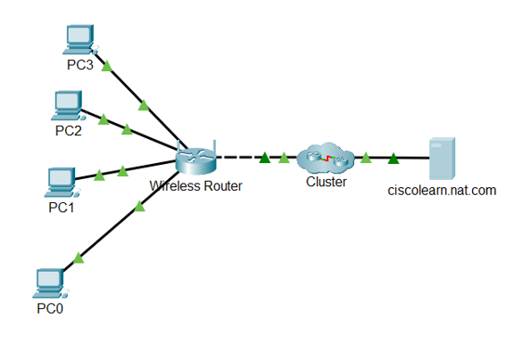
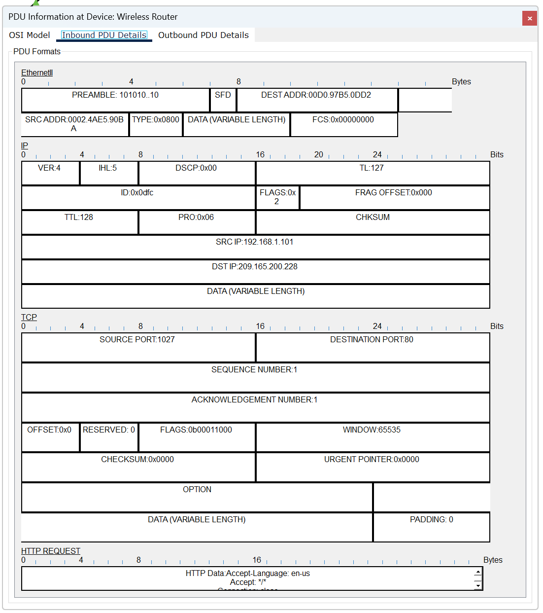
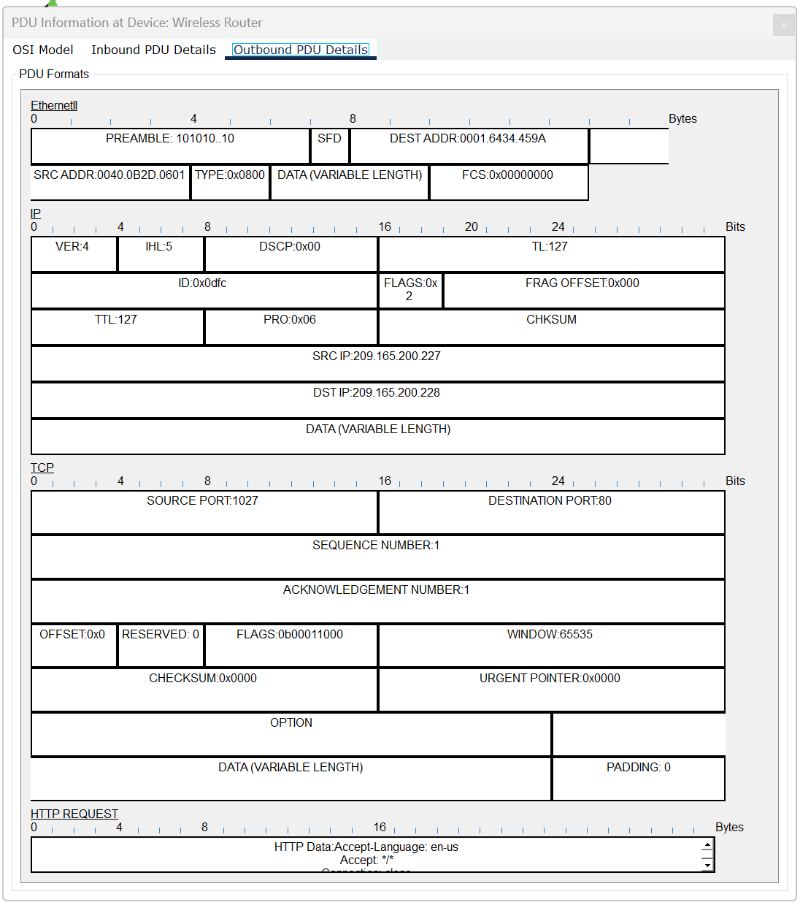
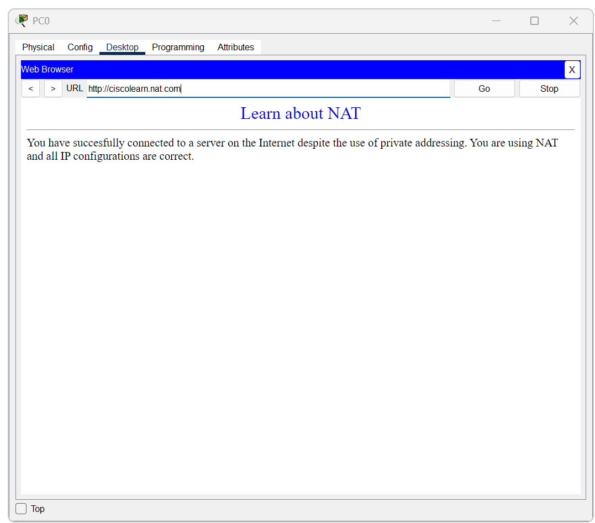

# Lab 02: NAT packet flow

[Week 02 overview](../README.md) | [Simulator availability](packet-tracer/README.md)

I compared an HTTP request entering and leaving a wireless router to observe source IPv4 translation. I then checked whether PC0 displayed the simulated external server's page.

I reused a Cisco learning activity for this exercise. Its source file is `lab-02-nat-packet-flow.pka`, not a `.pkt` file. The activity is not redistributed in this repository, and its extension has not been changed.

## Topology and addressing

PC0 connects to the router's LAN. The router connects through the activity's external network to `ciscolearn.nat.com`. The topology also contains PC1, PC2, and PC3, but the packet comparison and browser verification documented here concern PC0.

| Component | Recorded configuration | Evidence |
|---|---|---|
| PC0 | `192.168.1.101/24` | [Client ipconfig](../evidence/lab-02-nat/01c-nat-client-ipconfig.png) |
| PC0 gateway | `192.168.1.1` | Client ipconfig |
| Router WAN | `209.165.200.227/27` | [Router interface view](../evidence/lab-02-nat/01b-nat-router-interfaces.png) |
| Router WAN gateway | `209.165.200.225` | Router interface view |
| DNS server | `209.165.200.226` | Client and router views |
| HTTP destination | `209.165.200.228` | Inbound and outbound PDU details |

The screenshot named `01b-nat-router-interfaces.png` also shows the server's configured default gateway. The client output establishes the LAN gateway used by PC0; the screenshot does not display every router interface setting.

## Comparing the request at the gateway

I inspected the Inbound PDU Details and Outbound PDU Details at Wireless Router in Simulation Mode.

| Field | Inbound | Outbound | Interpretation |
|---|---|---|---|
| Source IPv4 | `192.168.1.101` | `209.165.200.227` | Source address translated |
| Destination IPv4 | `209.165.200.228` | `209.165.200.228` | Destination unchanged |
| Source TCP port | `1027` | `1027` | Preserved in this observation |
| Destination TCP port | `80` | `80` | Same destination service |
| TTL | 128 | 127 | Decremented during forwarding |
| IPv4 identification | `0x0dfc` | `0x0dfc` | Supports matching the request |
| TCP sequence number | 1 | 1 | Matching transport field |
| TCP acknowledgement number | 1 | 1 | Matching transport field |
| Application label | HTTP REQUEST | HTTP REQUEST | Same request type |

The inbound view shows PC0's private source address and the destination server address.

The outbound view shows the router's WAN address as the source. The destination remains the server. Matching identification, TCP fields, and application labels support comparing the same request across the gateway.

The Ethernet source and destination addresses also differ across the two views, consistent with forwarding onto a different link. That Layer 2 change is separate from source IPv4 translation. The TTL change is a forwarding effect, not evidence that NAT itself provides a security function.

## Application verification

I accessed `http://ciscolearn.nat.com` from PC0. The browser displayed the activity's NAT test page.

This supports application-level success for that simulated request. Although the page text refers to the Internet, the test used an external server inside Packet Tracer. It does not establish real Internet connectivity.

The browser result also supports receipt of the content needed to render the page. The saved evidence does not include a separate inspection of every return-path translation or the router's complete NAT table.

## Reproducing the comparison

Use an authorized copy of the original Cisco NAT activity, or construct a separate topology with equivalent routing, name resolution, HTTP service, and source translation. The screenshots do not specify all devices and configuration inside the collapsed external cluster, so they are not a complete configuration recipe for recreating that network from scratch.

1. Check PC0's configuration using `ipconfig /all`. Identify its gateway and DNS server.
2. Inspect the router's WAN configuration and the destination server used in the activity.
3. Enter Simulation Mode and generate an HTTP request from PC0 to the test hostname.
4. At Wireless Router, open the request's inbound and outbound PDU details.
5. Match the request using multiple fields. Compare addresses, ports, TTL, and application content.
6. Confirm the browser displays the page. Record a new result rather than assuming that another run must use source port `1027`.

These instructions describe how to repeat the observation, not a claim that documentation preparation reran the NAT lab.

## Findings and limits

- **Observed:** the source address changes from `192.168.1.101` to `209.165.200.227`; the destination and TCP ports remain the same in these captures; TTL decreases by one.
- **Inferred:** the matched fields support tracking the request through the gateway. The router represents PC0's outbound communication using its WAN address.
- **Verified by the recorded functional test:** PC0 displayed the simulated NAT page.
- **Not verified:** all NAT mappings, every client's behavior, port allocation under contention, a complete return-path packet analysis, and the stored activity's current state.

NAT can change transport ports, so this capture does not establish that ports are always preserved. NAT is not encryption and does not replace routing, authentication, firewall policy, or other security controls. This lab documents one observed translation and one successful HTTP access test.
