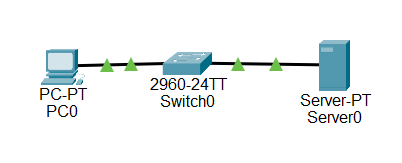
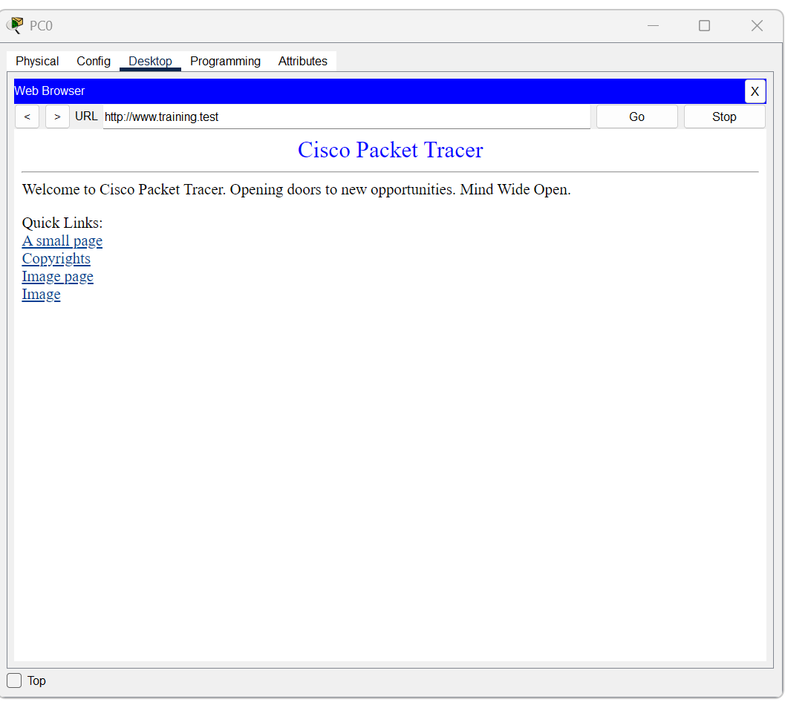
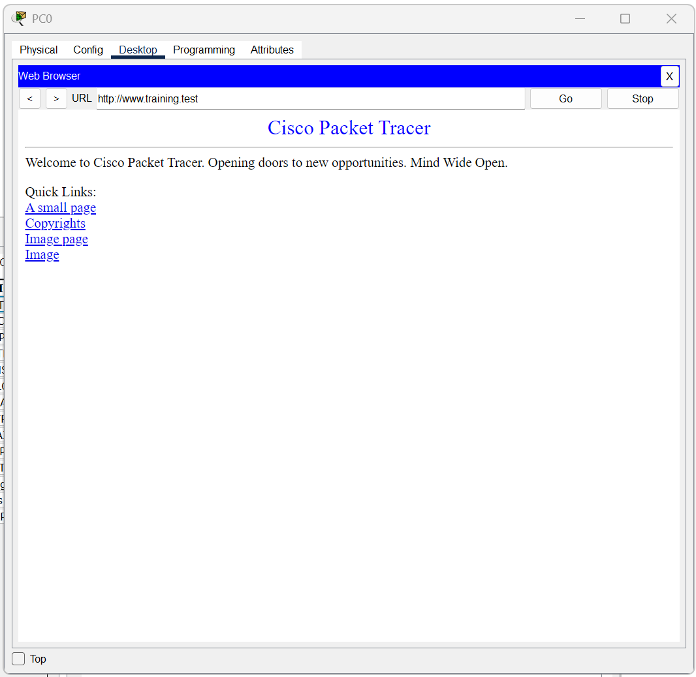

# Lab 03: DNS and HTTP troubleshooting

[Week 02 overview](../README.md) | [Packet Tracer project](packet-tracer/lab-03-application-troubleshooting.pkt)

I built this topology from scratch in Packet Tracer. I established working IP connectivity, DNS resolution, and HTTP access, then deliberately disabled HTTP to compare which tests still worked. I restored HTTP and checked the browser again.

This was a guided exercise with a known injected cause. It was not an independent investigation of an unknown incident or a production outage.

## Network and services



| Component | Configuration | Evidence |
|---|---|---|
| PC0 | `192.168.50.10/24` | [Client IP configuration](../evidence/lab-03-application/02a-pc0-ip-configuration.png) |
| Server0 | `192.168.50.20/24` | [Server IP configuration](../evidence/lab-03-application/02b-server0-ip-configuration.png) |
| Client DNS server | `192.168.50.20` | Client IP configuration |
| DNS A record | `www.training.test` to `192.168.50.20` | [DNS configuration](../evidence/lab-03-application/03a-dns-server-configuration.png) |
| Baseline HTTP / HTTPS | On / On | [HTTP configuration](../evidence/lab-03-application/03b-http-server-configuration.png) |

PC0 and Server0 share a subnet through a 2960-24TT switch. Both show gateway `0.0.0.0`. A default gateway is not required for the tested communication within this single subnet. The `.test` hostname is used inside the simulation; it is not a public website.

## Baseline: three different checks

I ran these commands on PC0:

```text
ping 192.168.50.20
nslookup www.training.test
```

The [baseline command output](../evidence/lab-03-application/04-connectivity-dns-baseline.png) shows four ICMP replies with zero loss and a DNS result of `192.168.50.20` for the hostname.

I then opened `http://www.training.test` in PC0's Web Browser.



These tests establish different facts. Ping supports IP reachability for the tested ICMP exchange. The lookup supports name resolution through the configured DNS server. The displayed page supports HTTP application success. No one test substitutes for the others.

## Fault injection: HTTP disabled

I switched HTTP Off on Server0's Services > HTTP page. HTTPS remained visibly On in the [fault configuration screenshot](../evidence/lab-03-application/06-http-service-disabled.png). DNS was not deliberately disabled.

I repeated the connectivity and DNS tests, then attempted to load the same HTTP URL.

| Test | Baseline | During the injected failure | Meaning of the failure-state result |
|---|---|---|---|
| Ping server IP | 4/4 replies | 4/4 replies | Tested IP reachability remained available |
| Resolve hostname | `192.168.50.20` | `192.168.50.20` | DNS still returned the expected address |
| Load HTTP page | Page displayed | Server Reset Connection | The browser did not obtain and display the requested page |

The [failure-state command output](../evidence/lab-03-application/07-connectivity-dns-during-failure.png) records successful ping and name resolution.


## Diagnosis and its limits

The controlled cause was the HTTP service being disabled. That setting is directly visible, and it was the service deliberately changed in this exercise. The failed page request was the consequence.

The successful ping and lookup show why a broad statement such as "the network is down" would be inaccurate. They do not prove that all network functions remained healthy, but they narrow what failed in the tested scenario.

The browser's Server Reset Connection message does not establish the exact TCP flag sequence, timing, or reset origin. No packet-level capture of this failure was reviewed. I therefore do not claim that the error alone proves a specific TCP exchange. HTTPS was visibly enabled, but HTTPS access was not tested.

## Recovery and functional verification

I re-enabled HTTP on Server0 and retried `http://www.training.test` from PC0.

- [Restored service configuration](../evidence/lab-03-application/09-http-service-restored.png): HTTP and HTTPS are On.
- [Recovery browser result](../evidence/lab-03-application/10-http-recovery-verified.png): the page displays again.



The service setting confirms configuration restoration. The browser result provides the functional recovery check. This distinction matters because a configured service alone does not prove the client can use it.

## Reproducing the exercise

Open a working copy of the linked `.pkt` file, or build the topology using one PC, one 2960 switch, and one server connected by Ethernet.

1. Set PC0 to `192.168.50.10` with mask `255.255.255.0` and DNS `192.168.50.20`.
2. Set Server0 to `192.168.50.20` with the same mask. Leave the gateway unset for this subnet-only test.
3. On Server0, enable DNS and add an A record for `www.training.test` pointing to `192.168.50.20`.
4. Enable HTTP and leave the default page available. HTTPS may remain enabled, but it is not the service under test.
5. Run the baseline ping and lookup on PC0, then load the HTTP URL. Record each outcome separately.
6. Disable only HTTP. Repeat all three tests and compare their results with the baseline.
7. Restore HTTP and retry the URL. Record both the service state and the displayed page.
8. Save a separate working copy if retaining new results. Preserve the supplied evidence and original file.

These are reproduction steps. They do not imply that the complete fault sequence was rerun during documentation review.

## Stored-file check on 18 October 2026

The project file's modification time predates the final recovery screenshots. A separate review therefore opened the exact Lab 03 file from disk rather than assuming its state from the images.

The reopened file had HTTP and HTTPS On, DNS On, and the expected A record. A fresh request from PC0 to `http://www.training.test` displayed the page. The review did not alter service settings or save over the original project.

This verifies that the stored project supports the tested HTTP access. It does not establish that it was saved after the original recovery event; an earlier working configuration can also pass the test.

## Evidence status

- **Observed:** addressing, DNS record, service states, command results, browser error, and recovery output are visible in the supplied screenshots.
- **Inferred:** the failure pattern is consistent with the deliberately disabled HTTP service while the tested IP and DNS exchanges remain available.
- **Verified:** the recorded baseline and recovery page loads succeeded. The reopened stored project also passed a fresh HTTP access check.
- **Not verified:** HTTPS access, detailed TCP failure behavior, other application services, performance under load, or independent diagnosis of an unknown fault.

The main lesson is to identify what each test proves before describing a root cause. A service-specific failure can coexist with successful IP connectivity and name resolution.
